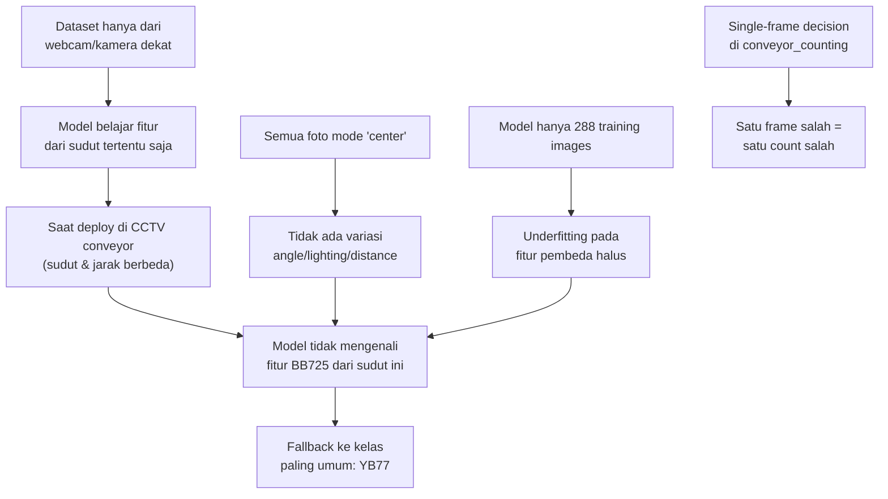

# 📊 Laporan Evaluasi Model — Pallet Variant Detection

**Tanggal**: 24 Juli 2026
**Sistem**: Conveyor Box Variant Counting & Pallet Variant Detector
**Kamera Aktif**: CCTV Line C2 (Conveyor BB725) — `rtsp://10.11.9.80`

---

## 1. Ringkasan Model Saat Ini

| Parameter | Nilai |
|---|---|
| **Arsitektur** | YOLOv8n (Nano) |
| **Base Model** | `yolov8n.pt` |
| **Training Device** | CPU |
| **Dataset** | 360 gambar (288 train / 72 val) |
| **Kelas** | 3 — Sachet_20gr_LunchBox, Variant_YB77, Variant_BB725 |
| **Epochs** | 80 (best epoch: **7**) |
| **Terakhir Di-train** | 19 Juni 2026 |

---

## 2. Metrik Training (Validation Set)

| Metrik | Nilai | Evaluasi |
|---|---|---|
| **mAP50** | **0.995** (99.5%) | ✅ Sangat tinggi |
| **mAP50-95** | **0.907** (90.7%) | ✅ Bagus |
| **Precision** | **0.981** (98.1%) | ✅ Sangat tinggi |
| **Recall** | **0.922** (92.2%) | ⚠️ Masih bisa ditingkatkan |

### Confusion Matrix (Validasi)


> [!NOTE]
> Confusion matrix menunjukkan **100% akurasi pada dataset validasi** — tidak ada misklasifikasi antar kelas. Semua 24 sampel per kelas diprediksi benar.

### Training Curves


> [!WARNING]
> **Best model tercapai di epoch 7 dari 80** — ini sangat dini. Artinya model sudah plateau (tidak belajar lebih lanjut) setelah epoch 7. Penyebab utama: **dataset terlalu seragam** (hanya mode `center`, tanpa variasi angle/lighting/distance).

---

## 3. Analisis Dataset

| Kelas | Jumlah | Mode Pengambilan |
|---|---|---|
| Sachet_20gr_LunchBox | 120 gambar | `center` only |
| Variant_YB77 | 120 gambar | `center` only |
| Variant_BB725 | 120 gambar | `center` only |
| **Total** | **360 gambar** | |

### Distribusi Split
- **Train**: 288 gambar (80%)
- **Validation**: 72 gambar (20%)

> [!CAUTION]
> **Kelemahan kritis dataset:**
> - Semua gambar diambil dari **satu sudut saja** (`center`)
> - Tidak ada variasi: `close`, `far`, `angle_left/right`, `low_light`, `high_light`
> - Gambar diambil dari **webcam/kamera dekat** tapi deployment di **CCTV conveyor** — ada domain gap besar
> - Timestamp menunjukkan foto diambil dalam hitungan detik → frame yang sangat mirip (kurang diversity)

---

## 4. Performa di Lapangan (Real-World — CCTV Conveyor)

### Data dari 9 Sesi Counting (Juni–Juli 2026)

| Tanggal | Total Box | YB77 | BB725 | JB | Low Conf (<0.8) | Line Aktual |
|---|---|---|---|---|---|---|
| 12 Jun | 12 | 12 | 0 | 0 | N/A | YB? |
| 13 Jun | 2 | 0 | 2 | 0 | N/A | BB? |
| 14 Jun | 25 | 25 | 0 | 0 | N/A | YB? |
| 17 Jun | 201 | 199 | **2** | 0 | 7 | YB |
| 19 Jun | 21 | 21 | 0 | 0 | 1 | YB |
| 30 Jun | 9 | 9 | 0 | 0 | 1 | YB |
| 02 Jul | 164 | 164 | 0 | 0 | 8 | YB |
| 04 Jul | 202 | 199 | **3** | 0 | 17 | YB |
| **24 Jul** | **4** | **2** | **2** | 0 | 1 | **BB ❌** |

> **Total**: 640 deteksi across 9 sessions

### Masalah Hari Ini — Line C2 (BB725)

```
ID: 2  → Variant YB 77   conf=0.7775  ← SALAH (harusnya BB)
ID: 6  → Variant BB 725   conf=0.9370  ✅ BENAR
ID: 10 → Variant YB 77   conf=0.8719  ← SALAH (harusnya BB)
ID: 13 → Variant BB 725   conf=0.8652  ✅ BENAR
```

**Akurasi hari ini di line C2 (BB)**: **50%** (2/4 benar) — sangat buruk!

### Pola Misklasifikasi

| Masalah | Detail |
|---|---|
| **BB725 → YB77** | 2 dari 4 box BB salah diklasifikasi sebagai YB |
| **Confidence saat salah** | 0.77–0.87 — cukup tinggi, model "yakin" tapi salah |
| **Di sesi lain (YB line)** | YB → BB terjadi 5 kali dari 636 deteksi (0.8% error) |
| **Overall misclassification** | ~1.1% di YB line, tapi **50%** di BB line hari ini |

---

## 5. Root Cause Analysis

### Mengapa model salah klasifikasi BB sebagai YB?



### Faktor Penyebab (Ranked)

| # | Faktor | Dampak | Solusi |
|---|---|---|---|
| 1 | **Domain gap** — foto training dari webcam, deploy di CCTV | 🔴 Tinggi | Tambah foto dari CCTV |
| 2 | **Kurang variasi** — hanya mode `center` | 🔴 Tinggi | Ambil foto multi-angle, multi-lighting |
| 3 | **Dataset kecil** — 120/kelas | 🟡 Sedang | Target 300+ per kelas |
| 4 | **Single-frame counting** — tidak ada voting | 🟡 Sedang | Implementasi majority voting per track ID |
| 5 | **Model Nano** — kapasitas terlalu kecil | 🟡 Sedang | Upgrade ke YOLO26s (Small) |
| 6 | **Overfitting** — best epoch 7 dari 80 | 🟡 Sedang | Data lebih beragam + augmentasi lebih agresif |

---

## 6. Status Upgrade YOLO26

| Tahap | Status | Keterangan |
|---|---|---|
| ✅ Upgrade training script | **Selesai** | `train_variant_model_v2.py` → YOLO26s |
| ✅ Upgrade detector script | **Selesai** | `pallet_variant_detector_v2.py` → YOLO26 |
| ⬜ Update ultralytics package | **Belum** | Perlu `pip install -U ultralytics` |
| ⬜ Tambah data CCTV ke dataset | **Belum** | Krusial untuk akurasi |
| ⬜ Re-train model YOLO26 | **Belum** | Butuh dataset yang sudah diperbaiki |
| ⬜ Fix conveyor_counting.py voting | **Belum** | Majority voting per track ID |

---

## 7. Rekomendasi Tindakan (Prioritas)

### 🔴 Prioritas Tinggi

1. **Tambah foto dari CCTV conveyor** ke dataset
   - Ambil screenshot dari CCTV line C2 (BB725) dan line YB77
   - Minimal 50-100 foto tambahan per kelas dari sudut CCTV
   - Gunakan `pallet_dataset_collector_v2.py` dengan source RTSP

2. **Tambah variasi mode pengambilan** di dataset
   - `close`, `far`, `angle_left`, `angle_right`, `low_light`, `high_light`
   - Saat ini 100% hanya `center` — sangat tidak representatif

3. **Implementasi majority voting** di `conveyor_counting.py`
   - Kumpulkan beberapa frame deteksi per track ID sebelum crossing
   - Ambil kelas mayoritas → mengeliminasi single-frame error

### 🟡 Prioritas Sedang

4. **Upgrade ultralytics** & re-train dengan YOLO26s
   - Script sudah siap, tinggal jalankan setelah dataset diperbaiki

5. **Naikkan confidence threshold** di conveyor counting
   - Saat ini 0.70, bisa dinaikkan ke 0.80 untuk mengurangi false positive

### 🟢 Prioritas Rendah

6. **Export model ke ONNX/TensorRT** untuk inference lebih cepat di edge device

---

## 8. Kesimpulan

> Model saat ini punya **metrik validasi sangat bagus** (mAP50=99.5%) tapi **performa lapangan rendah di line BB725** karena **domain gap** antara data training (webcam dekat) dan deployment (CCTV conveyor jarak jauh). Upgrade ke YOLO26 saja **tidak akan menyelesaikan** masalah ini tanpa **memperbaiki dataset** terlebih dahulu.
